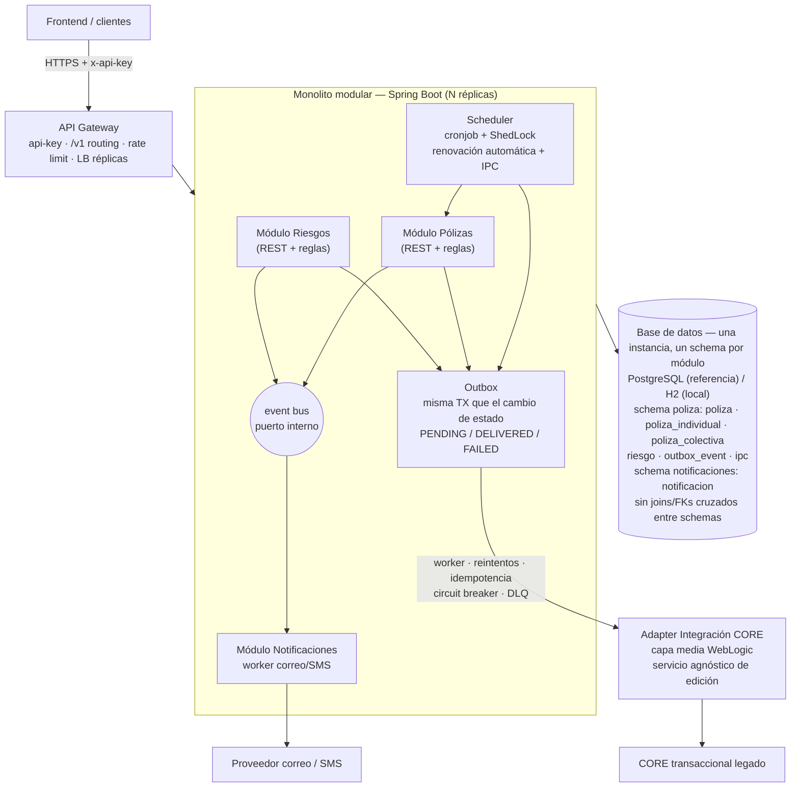

# Módulo 1 — Diseño de Sistema (System Design)

**Caso:** Plataforma de gestión de pólizas de arrendamiento (individuales y colectivas).

---

## 1. Arquitectura de alto nivel

Se propone un **monolito modular** sobre Spring Boot, organizado en módulos internos
con comunicación por eventos, con **integración asíncrona al CORE legado** mediante el
patrón **Outbox**, y un **borde único (API Gateway)** que centraliza seguridad y
versionamiento.

**Justificación de la forma de despliegue.** Es una primera implementación con equipo
pequeño y alcance acotado: un monolito modular da la velocidad de un solo despliegue
(sin orquestación de múltiples servicios) y, al mismo tiempo, fuerza límites de módulo
claros (Pólizas, Riesgos, Notificaciones, Integración CORE) que hacen la migración a
microservicios evolutiva y no un rewrite. La disponibilidad 24/7 se resuelve en esta
fase con réplicas stateless detrás de un balanceador; el estado vive en la base de
datos y en el outbox, nunca en memoria del proceso.

**Los flujos de la plataforma:**

1. **Flujo síncrono (borde):** el frontend consume la API REST (`/v1/polizas`, `/v1/riesgos`).
   Toda operación de escritura valida reglas de negocio, persiste el cambio y el evento
   de sincronización **en la misma transacción**, y responde al cliente sin esperar al CORE.
2. **Flujo asíncrono (interior):** un worker entrega los eventos del outbox al servicio
   agnóstico de edición (capa media WebLogic) con reintentos, idempotencia, circuit
   breaker y DLQ. La entrega "sí o sí" se garantiza con tracking y reintentos, no con
   latencia acoplada.
3. **Flujo de notificación:** creación y renovación de pólizas emiten eventos que un
   worker de notificaciones consume para despachar correo/SMS, con tracking de entrega
   en base de datos y reintentos ante fallo del proveedor.
4. **Renovación automática:** un scheduler (cronjob) escanea pólizas próximas a vencer,
   aplica el incremento del IPC sobre el canon, recalcula la prima, cambia el estado a
   `RENOVADA` y emite los eventos correspondientes. Con réplicas, el job usa lock de
   líder (ShedLock) para ejecutarse una sola vez.

**Decisión de migración declarada:** si la aplicación crece, la evolución natural es
microservicios + colas de mensajes + DLQ + workers por dominio. El monolito modular con
puertos abstraídos hace ese paso incremental: cada módulo ya tiene su borde definido.

**Ruta de extracción (por qué el diseño la abarata):** los módulos viven en schemas
separados sin joins ni FKs cruzados, y los vínculos entre módulos son por API/eventos
(con correlationId en el payload, no por FK). Extraer un módulo es entonces un
procedimiento operativo, no un rediseño: (1) `pg_dump` del schema del módulo y restore
en su propia BD; (2) repoint de credenciales del worker/adapter correspondiente;
(3) swap del event bus interno (un puerto) por el adapter de Kafka; (4) verificación con
reconciliación y contract tests — los eventos ya son el contrato de integración. El
costo del límite se paga hoy (alguna lectura que sería un join se vuelve una llamada al
API del módulo o un evento), a cambio de no desenredar contratos invisibles en producción.

---

## 2. Tres patrones de arquitectura y justificación

### 2.1 Hexagonal (Ports & Adapters)

El dominio (pólizas, riesgos, reglas de negocio: una individual solo tiene 1 riesgo, no
se renueva una póliza cancelada, la cancelación propaga a los riesgos, prima = canon ×
vigencia) vive aislado de la infraestructura. Los **puertos** son las interfaces que el
dominio necesita: persistencia, envío al CORE, publicación de eventos, proveedor de
notificaciones. Los **adapters** son las implementaciones concretas: JPA/H2 hoy
(PostgreSQL en el diseño de referencia), cliente HTTP hacia WebLogic, event bus interno,
SMTP/proveedor SMS.

**Por qué aquí:** la migración declarada a microservicios y el swap del event bus interno
por Kafka dependen de que infraestructura y dominio estén desacoplados. Con puertos, ese
swap es un adapter nuevo; sin ellos, es una reescritura. Además, las reglas de negocio
son el corazón de la prueba: hexagonal las mantiene testeables sin levantar infraestructura.

### 2.2 Event-Driven (con Outbox)

Los tres procesos que el enunciado exige son de naturaleza de eventos: notificaciones de
creación/renovación, renovación automática por expiración de vigencia, y sincronización
con el CORE. La API es **síncrona en el borde** y **dirigida por eventos en el interior**.
El cambio de estado y el evento se persisten en la misma transacción (outbox), lo que
elimina la dual-consistencia entre "lo que guardé" y "lo que reporté al CORE".

**Por qué aquí:** acoplar la respuesta HTTP a la latencia del CORE legado degrada la API
y el 24/7. Con outbox, el cliente siempre obtiene respuesta rápida y consistente con lo
persistido; el CORE se sincroniza eventualmente, con garantía de entrega via tracking
(`PENDING / DELIVERED / FAILED`), reintentos exponenciales con idempotencia-key, DLQ para
fallos permanentes y reconciliación periódica.

### 2.3 API Gateway (borde único)

Aunque un monolito puede funcionar sin gateway, aquí es el **borde único de entrada**:
exige el header `x-api-key`, ruterea `/v1` (y mañana `/v2`), aplica rate limiting,
balancea réplicas con health checks (parte del 24/7) y observa el tráfico de punta a punta.

**Por qué aquí:** el enunciado pide el componente en el diagrama, pero además el gateway
es la misma pieza que necesitará la migración a microservicios: cuando Pólizas, Riesgos
y Notificaciones sean servicios, el borde ya existe y solo cambia el routing.

**Patrones evaluados y descartados como pilares (no como rechazo):** *CQRS completo* es
sobre-ingeniería para este alcance; se adopta **CQRS-lite** como evolución (separar
queries de commands y réplicas de lectura) cuando el volumen lo justifique.
*Microservicios* es válido para el enunciado pero contradice la restricción real
(equipo pequeño, primera implementación); queda como roadmap, no como pilar.
*Saga* no se necesita como patrón formal en esta fase: la operación del cliente es una
transacción local ACID (cambio de estado + evento en outbox) y el flujo outbox →
tracking → DLQ → reconciliación ya cumple el rol de saga por coreografía con su
compensación (cuarentena de eventos `FAILED` + alerta). El saga se formaliza en la
migración a microservicios, cuando cada módulo tenga base propia y la escritura atómica
local deje de existir; trigger previo: que el negocio exija registro en CORE previo a la
validez de la póliza (se añadiría un estado `SINC_PENDIENTE` al ciclo de vida).

---

## 3. Modelo de datos principal

Modelo relacional (PostgreSQL como referencia; H2 en memoria para la ejecución local).
**Una instancia, un schema por módulo, sin joins ni FKs cruzados entre schemas:** los
módulos se comunican por API/eventos, nunca accediendo a tablas ajenas. Así, extraer un
módulo como servicio mañana equivale a mover su schema, sin remodelar datos. Las reglas
de negocio viven en el backend; la base conserva solo **constraints estructurales** como
última línea de defensa (FK, NOT NULL, CHECK de estados).

**Excepción deliberada:** `Riesgo` comparte el schema de `Poliza`. Forman un único
agregado transaccional — la regla "cancelar póliza cancela todos sus riesgos" exige
atomicidad inmediata — y separarlos obligaría a coordinar un saga para algo que es una
transacción local.

**Conexiones:** un único pool (HikariCP) sirve a toda la instancia; una conexión es a la
base de datos, no al schema, así que el schema viaja calificado en cada sentencia
(`@Table(schema = ...)` + Flyway con historial por schema). La prohibición de acceso
cruzado se aplica con un test de arquitectura (ArchUnit). Un pool por datasource aparece
al extraer un módulo a su propia BD, o antes solo si un módulo congestiona el pool —
viable porque no existen transacciones cruzadas entre módulos.

### Entidades

- **Poliza (base)** — tabla padre con lo común: id, tipo (`INDIVIDUAL`/`COLECTIVA`),
  estado (`ACTIVA`, `RENOVADA`, `CANCELADA`), fecha de inicio y fin de vigencia,
  canon mensual, prima (canon × meses de vigencia), tomador/asegurado/beneficiario
  según tipo, timestamps de auditoría.
- **PolizaIndividual / PolizaColectiva** — tablas hijas por estrategia JOINED: lo
  específico de cada tipo vive separado porque cada tipo evoluciona de forma
  independiente (la colectiva referencia a la inmobiliaria y sus arrendatarios
  asegurados; la individual al arrendatario tomador). Ninguna hereda de la otra:
  ambas heredan de la principal.
- **Riesgo** — tabla propia relacionada a la póliza (FK), con su propio estado
  (`ACTIVO`/`CANCELADO`) y datos del riesgo asegurado. La regla "una individual solo
  tiene 1 riesgo" y "solo colectivas agregan riesgos" se aplica en el service.
- **OutboxEvent** — tabla de integración: id, tipo de evento (`ACTUALIZACION`,
  `CREACION`, `RENOVACION`), payload, estado (`PENDING`/`DELIVERED`/`FAILED`),
  intentos, idempotency-key, timestamps. Se escribe en la misma transacción que el
  cambio de estado; el worker la drena.
- **Ipc** — tabla de soporte de la renovación: fecha de aplicación y porcentaje.
  Permite auditar qué IPC se usó en cada renovación y configurar el próximo.
- **Notificacion** — tracking de notificaciones: canal (`EMAIL`/`SMS`),
  destinatario, evento origen, estado de entrega, intentos.

### Relaciones

```
Poliza 1 ──── N Riesgo
Poliza 1 ──── N OutboxEvent (evento de sincronización al CORE)
Poliza 1 ──── N Notificacion
Ipc          (referenciada por fecha de aplicación en la renovación)
```

---

## 4. Pilares no funcionales

### 4.1 Escalabilidad

En este dominio **dominan las lecturas** (el front consulta pólizas y sus riesgos
frecuentemente; las escrituras son transacciones acotadas). Estrategia:

- **Réplicas horizontales stateless** del monolito detrás del gateway/balanceador.
- **Caché de lecturas frecuentes** (`GET /polizas`) con TTL corto e **invalidación al
  escribir** (crear/modificar/renovar/cancelar invalida la clave afectada).
- **Read replicas de la base** como fase posterior (CQRS-lite), no en la prueba: el
  volumen del caso no lo justifica y añade retención de consistencia.
- El estado nunca vive en memoria del proceso, por eso escalar es añadir réplicas.

**Cómo se manejan y "sincronizan" las réplicas.** Las réplicas de la aplicación **no se
sincronizan entre sí**: comparten el estado vía la base de datos y el caché — cualquier
réplica puede atender cualquier petición (sin sesiones HTTP; auth por `x-api-key`).
Los procesos periódicos se coordinan con locks en la BD: el cron de renovación usa
**ShedLock** (una sola réplica ejecuta por tick) y los workers del outbox son
**competing consumers** con `FOR UPDATE SKIP LOCKED` (cada evento lo procesa una
réplica, sin coordinación). Operativamente: balanceador con health checks
(`/actuator/health`), auto-restart en Kubernetes, HPA por CPU/RPS, config idéntica por
variables de entorno. Las **réplicas de lectura de la base** sí se replican por
*streaming replication*: la primaria escribe su WAL y las réplicas lo aplican en
continuo (asíncrono, lag de milisegundos) — escrituras 100% a la primaria, lecturas a
réplicas, con regla de **read-your-own-writes** (tras una escritura, la lectura de esa
póliza va a la primaria). Nota local: H2 embebido no sirve para multi-instancia (cada
proceso tendría su propia BD); para probar réplicas con k6 se usa PostgreSQL compartido
en Docker.

### 4.2 Logs y observabilidad

- **Logs estructurados (JSON)** con campos fijos: `timestamp`, `nivel`, `requestId`,
  `resumen corto`. Nada de texto libre ni payloads completos: los logs del flujo al
  CORE registran el intento y el resultado, no el body.
- **Correlation id de punta a punta:** nace en la petición de API y fluye
  API → outbox → worker → CORE → notificación (viaja en el payload del evento). Así se
  rastrea una renovación individual desde la petición HTTP hasta el correo enviado.
- **Métricas (Micrometer/Prometheus):** eventos outbox pendientes (backlog), tasa de
  fallo de entrega al CORE, estado del circuit breaker, latencia del CORE, tasa de
  renovaciones automáticas, fallos de notificación.
- **Alertas** sobre esas métricas: el caso "CORE rechaza un evento por datos inválidos"
  no se mitiga con reintentos (es fallo permanente) sino con DLQ + alerta + hotfix del
  contrato, respaldado por contract tests contra el CORE que detectan el drift de
  contrato antes de producción.

### 4.3 Tolerancia a fallos

- **Circuit breaker** en el cliente hacia el CORE (capa media WebLogic): si el CORE
  falla, se abre el breaker y entra el **modo degradado**.
- **Modo degradado:** la API sigue operativa al 100% para el cliente — las pólizas se
  crean, modifican, renuevan y cancelan localmente; sus sincronizaciones quedan en
  `PENDING` en el outbox y el cliente recibe la respuesta normal con aviso de estado
  degradado. Al recuperarse el CORE, el worker drena el outbox con reintentos
  exponenciales e idempotency-key (el CORE puede recibir duplicados lógicos, no efectos).
- **Fallo del proveedor de notificaciones:** reintentos + DLQ + alerta; el tracking en
  la tabla `Notificacion` permite reenvío controlado.
- **Fallos permanentes (ej. 400 del CORE):** nunca reintento infinito; van a DLQ con
  alerta para corrección manual/hotfix de contrato.
- **Reconciliación periódica** con el CORE para cerrar brechas de sincronización.
- **Renovación automática con lock de líder** (ShedLock) para que réplicas no la
  ejecuten en duplicado.

### 4.4 Concurrencia y saturación de la base

- **Lock optimista (`@Version`) en `Poliza` y `Riesgo`:** transiciones concurrentes
  (renovar vs cancelar sobre la misma póliza) revalidan la versión al escribir — el
  perdedor recibe `409`. La contención por fila es baja en este dominio; el lock
  optimista convierte la carrera en un conflicto explícito y reintentable.
- **Reglas check-then-act atómicas:** "una individual solo tiene 1 riesgo" se valida
  dentro de la misma transacción de la escritura (el update del estado toma el lock de
  fila y el concurrente revalida), con índice único de respaldo en la BD.
- **Cron vs API:** la renovación automática (ShedLock) y la manual comparten el mismo
  `@Version` — no hay doble aplicación.
- **El pool acotado es la válvula de saturación:** `maximumPoolSize` + `connectionTimeout`
  hacen que bajo carga extrema las peticiones fallen rápido (`503`) en vez de apilar
  conexiones que tumban la DB. Rate limiting en el gateway rechaza el excedente antes
  (`429`). Timeouts en toda la cadena (statement, `@Transactional(timeout=)`, HTTP al
  CORE) garantizan que nada retenga conexiones indefinidamente.
- **Bulkhead (Resilience4j)** en el cliente del CORE: su lentitud consume su propio
  compartimento, no los hilos ni conexiones del borde síncrono. La caché de lecturas
  absorbe el pico de consultas y el outbox desacopla los picos de sincronización.
- **Métricas de HikariCP** (conexiones activas, tiempo de espera por conexión) con
  alerta: la saturación se detecta antes de ocurrir.

**Modelo de capacidad bajo carga legítima (ej. 125k usuarios concurrentes con k6):**
usuarios concurrentes ≠ RPS — con ley de Little (1 petición por usuario cada ~10 s),
125k usuarios ≈ **12.5k req/s**. La carga se sostiene escalando, no bloqueando: réplicas
stateless detrás del balanceador (~2.5k RPS por instancia → ~5 réplicas), caché de
lecturas con alto hit ratio (deja la DB en ~2.5k req/s), virtual threads de Java 21
(eliminan el techo de 200 hilos de Tomcat), y **sizing global del pool** (la suma de
pools de todas las instancias debe caber en `max_connections` de la base). A ese volumen
de lectura se activa el trigger declarado de las **réplicas de lectura** (CQRS-lite).
El rate limiting por usuario no aplica a usuarios legítimos; lo que queda es admisión
de sobrecarga (`503 + Retry-After`) y la solución de fondo es escalar. H2 es para la
prueba local: bajo una prueba de carga seria, la base es PostgreSQL.

### 4.5 Versionamiento de APIs

- **Versionamiento por path** (`/v1/...`): explícito, fácil de rutear y filtrar en el
  gateway, y de depurar en logs.
- **Criterio de cambio breaking = compatibilidad hacia atrás:**
  - Añadir un campo **opcional** a `Poliza` **no es breaking** (los consumidores viejos
    lo ignoran) → no hay bump de versión.
  - Quitar/renombrar un campo, cambiar su tipo o su semántica **es breaking** → nueva
    versión `/v2` en paralelo, con ventana de deprecación de `/v1` y headers
    `Deprecation` / `Sunset` comunicados vía gateway.

---

## 5. Diagrama de componentes



**Lectura del diagrama:** todo el tráfico externo entra por el gateway (único borde con
seguridad y versión); los módulos del monolito comparten base de datos y se comunican
por el event bus (puerto interno); nada llega al CORE sin pasar por el outbox; las
notificaciones y la entrega al CORE son workers desacoplados que escalan y fallan de
forma independiente del borde síncrono.
