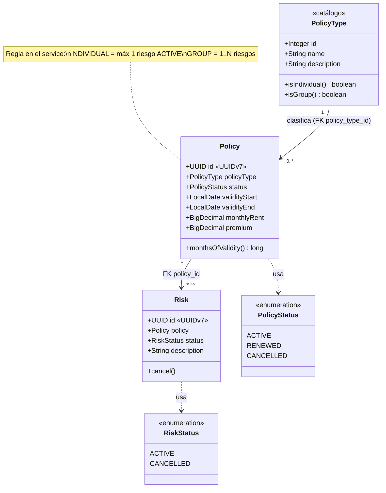
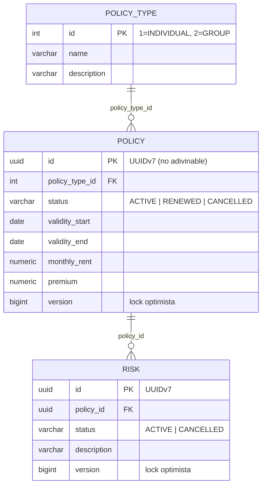

# Módulo 2 — UML del modelo de entidades

Modelo del dominio: **entidades independientes (sin herencia JPA)**. `policy_type` es el
catálogo; `policy` referencia el tipo por FK; `Risk` es entidad con identidad propia
(el "arreglo" vive en Java, las filas en la BD). La diferencia por tipo es **regla de
negocio del service**, no jerarquía de clases. Naming en inglés (estándar del usuario).

---

## 1. Diagrama de clases

---

## 2. Modelo físico (ER)

Ambas tablas viven en el schema `policy`; `outbox_event` e `ipc` también (mismo módulo),
`notification` en el schema `notifications`.

---

## 3. Ejemplo con filas

| `policy_type` (catálogo) |              |                          |
|--------------------------|--------------|--------------------------|
| 1                        | INDIVIDUAL   | Holder/insured: lessee…  |
| 2                        | GROUP        | Insured: lessees…        |

| `policy` (una sola tabla; id = UUIDv7) |        |        |
|---------------------------|--------|--------|
| id=`0194a7c3-…a1`, **policy_type_id=1**| …      | (INDIVIDUAL) |
| id=`0194a7c5-…b2`, **policy_type_id=2**| …      | (GROUP)      |

| `risk` (cada fila = un elemento del "arreglo" de su póliza; id = UUIDv7) |          |
|---------------------------------------------------------------|----------|
| id=`0194a7c6-…c1`, **policy_id=`0194a7c3-…a1`**, ACTIVE        | individual → 1 riesgo |
| id=`0194a7c7-…d2`, **policy_id=`0194a7c5-…b2`**, ACTIVE        | colectiva → |
| id=`0194a7c8-…e3`, **policy_id=`0194a7c5-…b2`**, ACTIVE        | varios riesgos |
| id=`0194a7c9-…f4`, **policy_id=`0194a7c5-…b2`**, CANCELLED     | (N filas)  |

---

## 4. Por qué cada riesgo tiene id y estado propios

El enunciado exige cancelar **un** riesgo por id — eso exige identidad y ciclo de vida
propios por riesgo. Un arreglo embebido (JSON/columna) no podría exponer ese contrato.

> **Resumen:** el **arreglo** (`List<Risk>`) es cómo se ve en Java; las **filas con FK**
> es cómo se guarda en la BD; el **límite** (1 vs N) es una **regla del service**;
> el **tipo** es un **FK al catálogo**, no una jerarquía de clases.
